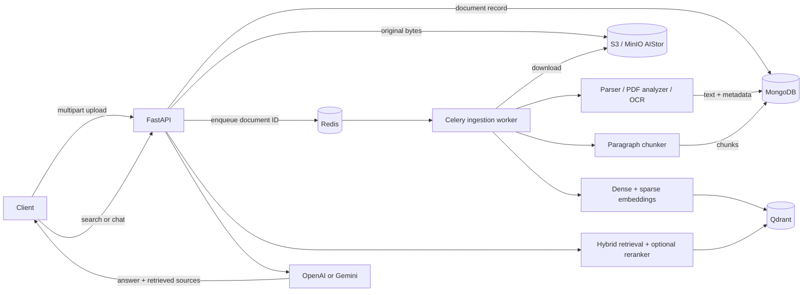

# Document Intelligence

## Overview

Document Intelligence is a document-question-answering API for financial documents. It accepts common office, spreadsheet, image, and PDF formats; extracts their text; indexes paragraph-sized chunks with dense and sparse embeddings; and answers questions from retrieved document context. It is intended to make uploaded financial material searchable while returning the retrieved chunks used as sources.

The service exposes a FastAPI HTTP API, delegates extraction and indexing to a Celery worker, stores original uploads in S3-compatible object storage, keeps document records and chunks in MongoDB, and searches vectors in Qdrant.

## Key features

- Upload and asynchronously process `.txt`, `.csv`, `.xls`, `.xlsx`, `.pdf`, `.docx`, `.pptx`, and image files (`.png`, `.jpg`, `.jpeg`, `.tif`, `.tiff`, `.bmp`, `.webp`, `.gif`).
- Extract text and selected metadata from text, CSV, Excel, Word, and PowerPoint files. Excel, Word, and PowerPoint extraction includes worksheet/table/slide text where applicable.
- Analyze PDFs as native-text, image, or hybrid PDFs. Image PDFs are OCRed with OCRmyPDF; hybrid PDFs OCR only pages selected by the analyzer.
- OCR standalone images using Tesseract after grayscale conversion and enlargement; OCR details are retained in document metadata.
- Split extracted content on blank-line paragraph boundaries and persist chunks in MongoDB.
- Create dense `BAAI/bge-m3` embeddings plus sparse `Qdrant/bm25` embeddings, then use Qdrant reciprocal-rank-fusion hybrid retrieval. An optional CrossEncoder reranker refines results.
- Answer and stream retrieval-augmented questions through configured OpenAI or Gemini models. Non-streaming answers include retrieved source chunks and scores.
- Track document states (`QUEUED`, `PROCESSING`, `COMPLETED`, `FAILED`) and clean up MongoDB, Qdrant, and object-storage records when a document is deleted.

## Technology stack

| Component | Role |
| --- | --- |
| Python 3.14+ and `uv` | Application runtime and dependency management. |
| FastAPI + Uvicorn | HTTP API, OpenAPI documentation, and development server. |
| Celery + Redis | Background ingestion queue, result backend, and task state tracking. |
| MongoDB | Document records, extracted text/metadata, chunks, and seeded LLM-model configurations. |
| MinIO AIStor / S3 | Original uploaded-file storage through `boto3`. Any S3-compatible endpoint can be configured. |
| Qdrant | Dense and sparse vectors, hybrid retrieval, and document-scoped filtering. |
| Sentence Transformers, FastEmbed | Dense and sparse embedding generation; Sentence Transformers also provides the optional reranker. |
| PyMuPDF, OCRmyPDF, Tesseract, OpenCV, Pillow | PDF analysis/extraction and image/PDF OCR. |
| LangChain provider integrations | OpenAI and Gemini chat-model adapters. |

## Architecture



Uploads return after the API has stored the source file and queued a task; parsing, chunk persistence, and vector indexing occur in the worker. Search and chat requests are synchronous. Documents store their extracted `content` and parser metadata in MongoDB; raw originals live in object storage; Qdrant payloads contain chunk identifiers, document identifiers, indexes, content, and chunk metadata.

## Prerequisites

- Python **3.14 or later** (the project declares `requires-python = ">=3.14"`).
- [uv](https://docs.astral.sh/uv/) for installing and running the project.
- Docker Engine with Docker Compose for the local Redis, MongoDB, MinIO AIStor, Qdrant, and Flower services.
- A working **Tesseract** installation for standalone-image OCR and hybrid-PDF OCR. OCRmyPDF also requires its system-level dependencies; install them according to [OCRmyPDF's installation guidance](https://ocrmypdf.readthedocs.io/en/latest/installation.html) for your platform.
- Network access on first run to download the configured embedding/reranker model weights. Set `HF_TOKEN` when the selected Hugging Face model requires it.
- At least one API key and matching enabled LLM model configuration to use `/chat`. The initial model configurations are seeded from [`app/data/llm_models.json`](app/data/llm_models.json).

## Installation and setup

```bash
git clone <repository-url> document-intelligence
cd document-intelligence
cp .env.example .env
uv sync --all-groups
```

Edit `.env` with local, development-only values. `MONGODB_URI`, `S3_ACCESS_KEY`, and `S3_SECRET_KEY` are required by the settings class. When using the bundled Compose file, MongoDB is started with authentication while `.env.example` uses an unauthenticated URI; set `MONGODB_URI` to a URI appropriate for that Compose authentication configuration. Do not commit `.env`.

Start local infrastructure:

```bash
docker compose up -d
```

The application does **not** create the configured S3 bucket. Before uploading, create the bucket named by `S3_BUCKET` in the MinIO console (the Compose mapping exposes it at `http://localhost:9001`) or in your chosen S3-compatible service. Also ensure the `S3_ENDPOINT` and credentials in `.env` match that service.

In separate terminals, run the API and the worker:

```bash
uv run uvicorn app.api.main:app --reload
```

```bash
uv run celery -A app.worker.celery:celery worker --loglevel=info --pool=solo
```

The repository wrapper provides equivalents:

```bash
./cmd.sh start    # starts Compose, then the reload server
./cmd.sh worker   # starts the Celery worker
./cmd.sh flower   # starts Flower on port 5555
```

`./cmd.sh start` keeps the API process in the foreground, so start `./cmd.sh worker` in another terminal. Compose also starts a Flower container; use either that service or the wrapper command, rather than both, if one port 5555 listener is sufficient.

## Environment variables

The authoritative settings are in [`app/config.py`](app/config.py). Pydantic reads `.env` and ignores unrecognized variables.

| Group | Variable | Required | Default | Purpose |
| --- | --- | --- | --- | --- |
| MongoDB | `MONGODB_URI` | Yes | — | MongoDB connection URI. |
| MongoDB | `MONGODB_DATABASE` | No | `document_intelligence` | Database for document, chunk, and LLM-model collections. |
| Qdrant | `QDRANT_URL` | No | `http://localhost:6333` | Qdrant server URL. |
| Qdrant | `QDRANT_COLLECTION` | No | `document_chunks` | Hybrid vector collection name. |
| S3 | `S3_ENDPOINT` | No | `http://localhost:9000` | S3-compatible endpoint URL. |
| S3 | `S3_ACCESS_KEY` | Yes | — | Object-store access key. |
| S3 | `S3_SECRET_KEY` | Yes | — | Object-store secret key. |
| S3 | `S3_REGION` | No | `us-west-1` | Region supplied to the S3 client. |
| S3 | `S3_BUCKET` | No | `document-intelligence-raw` | Existing bucket used for raw uploads. |
| Uploads | `MAX_UPLOAD_FILES` | No | `10` | Maximum files in one request. |
| Uploads | `MAX_FILE_SIZE` | No | `26214400` (25 MiB) | Maximum size of one uploaded file, in bytes. |
| Uploads | `MAX_TOTAL_UPLOAD_SIZE` | No | `104857600` (100 MiB) | Maximum combined request size, in bytes. |
| Embeddings | `EMBEDDING_MODEL` | No | `BAAI/bge-m3` | Dense Sentence Transformer model. |
| Embeddings | `SPARSE_EMBEDDING_MODEL` | No | `Qdrant/bm25` | Sparse FastEmbed model. |
| Embeddings | `HF_TOKEN` | No | `null` | Hugging Face token passed to the dense model loader. |
| LLMs | `OPENAI_API_KEY` | No* | `null` | Required when the selected model references `OPENAI_API_KEY`. |
| LLMs | `GEMINI_API_KEY` | No* | `null` | Required when the selected model references `GEMINI_API_KEY`. |
| Reranking | `RERANKER_ENABLED` | No | `true` | Enables CrossEncoder reranking and startup model warm-up. |
| Reranking | `RERANKER_MODEL` | No | `BAAI/bge-reranker-v2-m3` | CrossEncoder model name. |
| Reranking | `RERANKER_TOP_K` | No | `10` | Candidate count requested before reranking. |

\* An LLM key is optional for file processing and `/search`, but required for a chat request that selects the corresponding provider. Model configurations are stored in MongoDB and seeded at API startup.

## Running the application

The API warms the dense and sparse embedding models at startup, and also warms the reranker when it is enabled. It pings MongoDB and seeds the configured LLM models during startup; model downloads or unavailable services can therefore prevent startup.

Once the API is running, verify it with:

```bash
curl http://127.0.0.1:8000/health
# {"status":"ok","database":"ok"}
```

FastAPI serves interactive documentation at `http://127.0.0.1:8000/docs` and the OpenAPI schema at `http://127.0.0.1:8000/openapi.json`.

## Document processing pipeline

1. `POST /files` validates the number, size, and extension of all files before storing or queueing them.
2. The API creates a MongoDB document record with status `QUEUED`, writes the original to `uploads/<document_id>/original` in the configured bucket, then sends the document ID to Celery.
3. The worker marks the document `PROCESSING`, downloads the original, and picks a parser by filename extension.
4. PDFs are analyzed page by page. Native-text PDFs use PyMuPDF extraction; image-only PDFs are processed by OCRmyPDF and then extracted with PyMuPDF; hybrid PDFs use PyMuPDF OCR only for pages that lack text or have short text plus high image coverage. Empty PDFs are rejected by the parser factory.
5. The worker splits non-empty paragraphs into chunks, saves them to MongoDB, creates dense and sparse embeddings, ensures the Qdrant collection exists, and upserts vector payloads.
6. It saves the extracted content and parser metadata on the document and marks it `COMPLETED`. Any exception records the error, sets `FAILED`, and is retried by Celery up to three times with backoff.

Search embeds the query in both spaces, fuses dense and sparse Qdrant candidates with reciprocal-rank fusion, optionally reranks them, and can filter by a document ID. Chat uses those results as document context and returns the sources used. The configured prompt instructs the model to use only supplied context and to avoid presenting financial advice as fact.

## API usage

All paths below are relative to `http://127.0.0.1:8000`.

| Method and path | Purpose | Request |
| --- | --- | --- |
| `GET /health` | Check API and MongoDB availability. | None. |
| `POST /files` | Store one or more files and queue ingestion. | Multipart form field `files`; repeat it for multiple files. |
| `GET /files` | List documents. | Optional `page` (>=1, default `1`), `page_size` (1–100, default `20`), `status`. |
| `GET /files/{document_id}` | Get a document, extracted content, parser metadata, status, and error. | MongoDB ObjectId path parameter. |
| `DELETE /files/{document_id}` | Delete a document, its vectors, chunks, and original object. | MongoDB ObjectId path parameter. |
| `GET /search` | Retrieve relevant chunks. | Required `q`; optional `limit` (1–20, default `5`) and `document_id`. |
| `POST /chat` | Return a RAG answer and source chunks. | JSON with `question`, `model_id`, optional `document_id`, optional `limit`. |
| `POST /chat/stream` | Stream a RAG answer as server-sent events. | Same JSON body as `POST /chat`. |

### Upload and inspect a document

```bash
curl -X POST http://127.0.0.1:8000/files \
  -F 'files=@./statement.pdf;type=application/pdf'
```

The response has this shape; retain `document_id` to poll status or scope later requests:

```json
{
  "count": 1,
  "files": [
    {
      "document_id": "<mongo-object-id>",
      "task_id": "<celery-task-id>",
      "filename": "statement.pdf",
      "size": 12345,
      "status": "QUEUED"
    }
  ]
}
```

```bash
curl 'http://127.0.0.1:8000/files/<mongo-object-id>'
curl 'http://127.0.0.1:8000/files?page=1&page_size=20&status=COMPLETED'
```

`GET /files` returns `items`, `page`, `page_size`, and `total`. Each item includes `document_id`, filename, content type, size, status, creation time, and processing time. `GET /files/{document_id}` additionally includes `error`, extracted `content`, and `metadata`.

### Search

```bash
curl --get 'http://127.0.0.1:8000/search' \
  --data-urlencode 'q=What was the operating income?' \
  --data-urlencode 'limit=5' \
  --data-urlencode 'document_id=<mongo-object-id>'
```

The response contains the normalized `query` and `results`. A result contains `score`, `chunk_id`, `document_id`, `chunk_index`, `content`, and `metadata`; with reranking enabled, it also retains the initial score as `vector_score`.

### Ask a question

`model_id` is the MongoDB ObjectId of an enabled record in `llm_models`, not its seed name. The API seeds `gemini-primary` and `openai-primary` configurations at startup, but it does not expose a route for listing them; obtain the ID from the database or your own provisioning workflow.

```bash
curl -X POST http://127.0.0.1:8000/chat \
  -H 'Content-Type: application/json' \
  -d '{
    "question": "Summarize the reported revenue.",
    "model_id": "<llm-model-object-id>",
    "document_id": "<mongo-object-id>",
    "limit": 5
  }'
```

The response has `answer` and `sources`. Each source has `document_id`, `chunk_id`, `chunk_index`, `score`, `content`, and `metadata`. If retrieval finds no chunks, chat returns a fixed no-relevant-information answer with an empty `sources` list.

For streaming, send the same body to `/chat/stream`. The endpoint returns `text/event-stream` records shaped as `data: {"token":"..."}` and finishes with `data: [DONE]`.

## Testing and code quality

The default pytest configuration excludes tests marked `integration`.

```bash
./cmd.sh test
# or
uv run pytest

# Target a module or test
uv run pytest tests/api/test_files.py
uv run pytest tests/services/parsers/pdf/test_analyzer.py
```

Run configured Ruff checks and formatting checks with:

```bash
./cmd.sh check
./cmd.sh format
```

The project does not configure a separate type checker. Tests cover routes, document/chunk services, ingestion orchestration, vector-search behavior, LLM provider/RAG logic, and parser/PDF fixtures. Integration tests are available only when explicitly selected, for example `uv run pytest -m integration`; they require the relevant external services.

## Project structure

```text
app/
├── api/                 # FastAPI application, middleware, and routes
├── data/                # Seed LLM model configurations
├── db/                  # MongoDB client and startup seeding
├── models/              # Pydantic document, chunk, chat, and LLM models
├── prompts/             # RAG system prompt
├── services/            # Storage, ingestion, chunking, retrieval, and LLM services
│   ├── llm/             # Provider factory and OpenAI/Gemini adapters
│   └── parsers/         # Document parsers, PDF analysis, and OCR paths
└── worker/              # Celery configuration and ingestion task
scripts/                 # PDF fixture download and inspection helpers
tests/                   # Unit, API, worker, parser, and integration tests
docker-compose.yml       # Local Redis, AIStor, MongoDB, Qdrant, and Flower
cmd.sh                   # Start, worker, test, lint, and formatting wrapper
```

## Troubleshooting

- **The API exits during startup:** it pings MongoDB and loads embedding models during its lifespan startup. Confirm `MONGODB_URI`, MongoDB availability, model download access, and (if enabled) the reranker model. For a smaller startup surface while diagnosing embeddings, set `RERANKER_ENABLED=false`; dense and sparse embeddings are always warmed.
- **Upload fails with an S3/NoSuchBucket-style error:** create `S3_BUCKET` first and verify `S3_ENDPOINT`, access key, secret key, and the selected bucket. The application does not provision buckets.
- **Worker cannot consume tasks:** Redis is fixed in [`app/worker/celery.py`](app/worker/celery.py) to `redis://localhost:6379/0`; ensure Redis is listening there and run the worker command from this repository.
- **OCR fails:** verify that the `tesseract` executable and OCRmyPDF prerequisites are installed and available on `PATH`. Image OCR and hybrid-PDF extraction call Tesseract through their Python bindings; image-only PDF extraction invokes OCRmyPDF.
- **A document stays `FAILED`:** inspect `GET /files/{document_id}` for the persisted `error` value and the Celery worker logs. Failures are retried up to three times before Celery stops retrying.
- **Chat returns a credential error:** configure the API key required by the selected model's `credential_ref` and make sure its MongoDB model record is enabled. `model_id` must be a valid enabled LLM-model ObjectId.
- **No search/chat results after upload:** wait for `status` to become `COMPLETED`, then check the worker logs and Qdrant availability. Documents with no extractable text can fail parsing or produce no chunks.

## Security and configuration notes

- Keep `.env`, API keys, S3 keys, and database credentials outside version control. Use a secret manager or deployment environment variables outside local development.
- Configure the Compose-provided credentials only for local development; replace them for shared or production deployments.
- The API currently permits CORS requests only from `http://localhost:3000` and `http://127.0.0.1:3000`. No application-level authentication or authorization is implemented in this repository, so place the service behind appropriate access controls before exposing it.
- Uploaded documents and extracted content may contain sensitive financial information. Protect the configured object store, MongoDB, Qdrant, Redis, and their network access accordingly.

## Limitations and future improvements

- Chunking is paragraph-based and has no configurable chunk size or overlap.
- The Celery broker and backend URLs are hard-coded to local Redis; they are not environment-configurable in the current code.
- There is no API route to list or administer LLM model configurations, even though records are seeded at startup.
- Object-bucket creation is an external setup step.
- Parser selection is extension-based, and only the formats registered in [`app/services/parsers/__init__.py`](app/services/parsers/__init__.py) are accepted.

## Contributing

Keep changes focused, add or update tests under `tests/` for behavior changes, and run:

```bash
./cmd.sh check
./cmd.sh test
```

Do not add credentials, generated caches, or local `.env` files to commits. For PDF parser work, the repository includes fixture helpers in [`scripts/`](scripts/).
